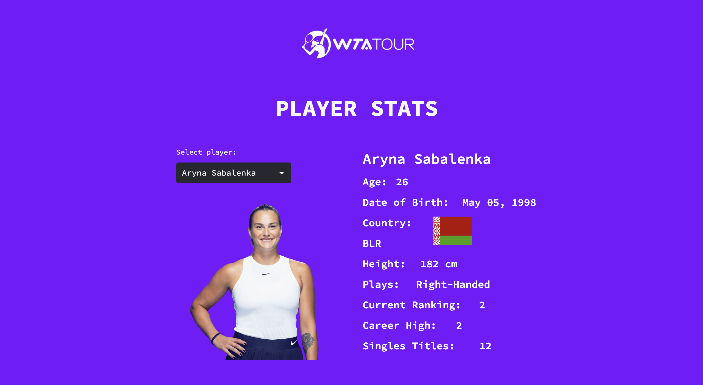

# 🎾 WTA Tennis Player Stats Web App

A Streamlit web application that allows users to explore historic data on WTA (Women’s Tennis Association) players from 1980 to 2023. The app lets you:
	•	Search for a specific player
	•	Visualize player statistics and career information
	•	Compare two players and view the head-to-head match history and results

⸻

🧠 Project Overview

This project analyzes a historic WTA dataset containing player profiles and match outcomes.
The main goal was to make tennis data accessible and interactive through a simple, web-based interface.

The app combines data exploration and sports analytics, enabling users to gain insights into players’ matches, performance, and career trajectory.

⸻

🚀 Features
	•	🔍 Player Search: Find any player from 1920–2023
	•	📊 Player Overview: View player info, match records, and statistics
	•	⚔️ Head-to-Head Comparison: Select two players to see their match history and results
	•	🌐 Streamlit Web Interface: Clean, fast, and user-friendly

⸻

🛠️ Tech Stack
	•	Python – Data processing and backend logic
	•	Streamlit – Web application framework
	•	Pandas / NumPy – Data manipulation and analysis

⸻

📹 Demo

🎥 Watch Demo Video
[You can check a demo here](https://drive.google.com/file/d/1ptALclc_DiWsR2WMaBWVwcQmIfZX3n0b/view?usp=sharing)

🌍 Try the Web App
[You can check it out here](https://andreaquirozo-wta-players-wta-qury7r.streamlit.app/)

⸻

📂 Dataset
	•	Source: [Jeff Sackmann](https://github.com/JeffSackmann/tennis_wta) 
	• Ranking (dqte, points, player)
	•	Player details (name, nationality, ranking, photo, etc.)
	•	Match results (date, surface, tournament, score)

Dataset from Jeff Sackmann’s Tennis Abstract, licensed under CC BY-NC-SA 4.0.

⸻

📊 Example Use Cases
	•	Explore a player’s career performance
	•	Compare head-to-head records between tennis players

⸻

💡 Future Improvements
	•	Incorporate analytics and visualizations to gain insights into players’ performance trends
	•	Automate incorporation of latest data
	•	Add player similarity recommendations using machine learning algorithms

